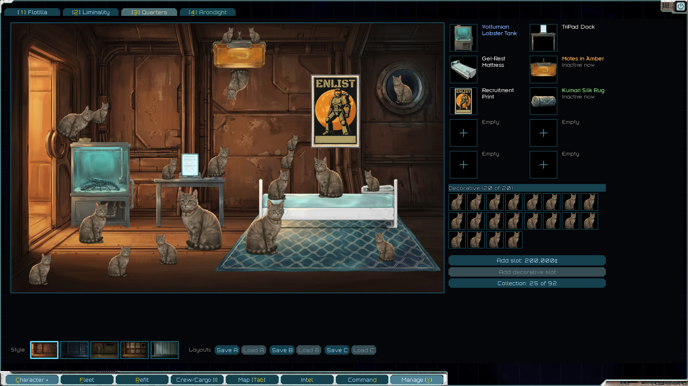
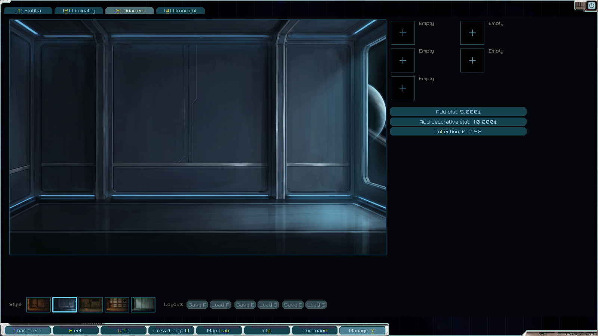
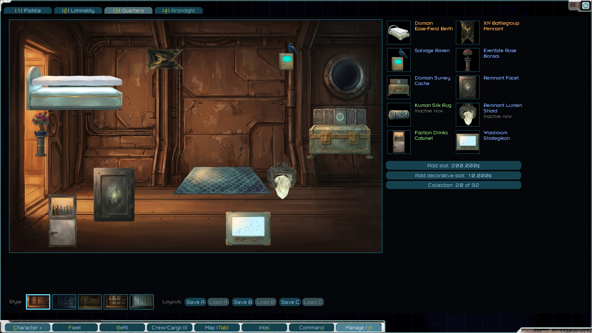
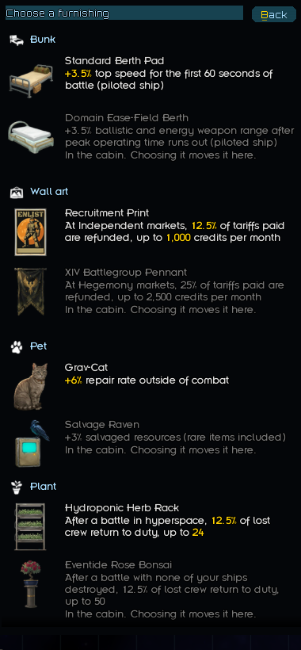

# Captain's Quarters
> The cat outranks you.

Design your cabin, on the Management screen. Furnish it with things you pick up in your travels, arrange them how you like, restyle the room, add decorative slots.

Furnishings turn up in market stock, in old stations, in battle salvage, and as quest rewards.

Also adds a Survival Mode start that lets you choose your ships. This is completely unrelated to the rest of the mod FYI, I just already have 5 mods and that's enough to manage. This seemed like the least objectionable mod to shove this in.

No required dependencies. Can be added to existing saves. Full survival-mode support.

[Forum link](https://fractalsoftworks.com/forum/index.php?topic=35860.0)

## Screenshots

